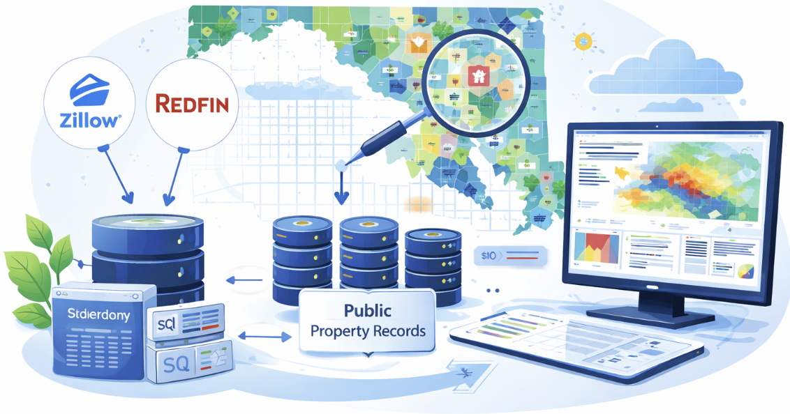

# Selected Projects in Data Science, Machine Learning, and NLP, etc.

---

### ZIP-Code–Driven Real Estate Data Ingestion & Analytics Platform

Designed and implemented a data ingestion and enrichment pipeline that aggregates real-estate listings by ZIP code across multiple major platforms. The system normalizes site-specific schemas and merges results with public Maryland property records stored in an on-prem SQL database, producing clean, analytics-ready datasets.

The resulting data model is structured to support downstream geospatial visualization and ZIP-level analysis, enabling interactive exploration of property attributes once connected to a visualization layer.

 

---

### Angel Reese v. Caitlin Clark: Few-shot learning Sentiment Analysis with GPT-3.5

Sentiment analysis is target-oriented, aiming to identify opinions or attitudes towards topics or entities. In this project, I built a text classifier using OpenAI's Chat API, combined with a semantic similarity pipeline using SBERT for generating optimized prompt examples. 

 

     
  

[View code on Colab](https://colab.research.google.com/drive/1QdwMAsxRfX_XVrdrPs0Rfdxqs-Yyoid8?usp=sharing)

---

### Creating a Cross-Cultural music reccomendation system with Machine Learning

Developed a cross-cultural music recommendation system using Spotify API, audio feature extraction, unsupervised learning, clustering algorithms, matrix factorization, content-based and collaborative filtering to generate personalized playlists tailored to taste profiles.

For this, I used various ML techniques including: (i) Kmeans++, KNN (ii) Content-Based Filtering (iii) Collaborative Filtering (KnnBasic) (iv) Matrix Factorization (Singular Value Decomposition, Alternating Least Squares, and Non-negative Matrix Factorization)

    

[View code on Colab](https://colab.research.google.com/drive/1Jg6GWEcf4zMfkK2gsJuHeObspYo4_o5d?usp=sharing)

---

### spotify2mp3 - Downloading your favorite Spotify Playlists to your local folder. 
This Project makes use of HTTP requests, the Spotify API, YouTube API, and finally selenium to import a Spotify playlist to a local folder on your device.

      
  

[View code on GitHub](https://github.com/williamzabet/spotify2mp3)

---

## Additional Projects & Exploratory Work
A selection of smaller projects focused on algorithmic problem-solving, exploratory analysis, and foundational data science concepts.

- [**To Read or Not to Read** — Visualizes a personal library by comparing books using textual content and metadata similarity; allows unread books to be spatially compared relative to the existing collection](https://github.com/williamzabet/To-Read-Or-Not-To-Read)

